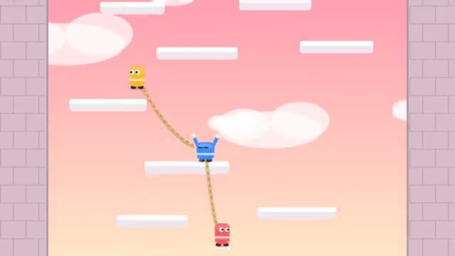

# Rope Climb

Roped together. One slip drags you all down. A multiplayer starter game from [Multiplayer Agent](https://multiplayeragent.com): 2D, co-op, 2–4 players, with a bot partner when you're alone.

## How it plays

Climb a tall tower as a team, tied together by a rope. If a partner slips while nobody holds on, the rope drags you after them. Hold Grip to dig in and catch them, then haul them back up. Rest ledges every 25 m catch any fall. Your team's height is its lowest climber; climb as high as you can in three minutes.

**Controls:** Arrows or A/D to walk, Space to jump, hold Shift or S to grip (grip + Space hauls your partner up). On touch: ◀ ▶, Jump and Grip.

## Make it yours in the Game Builder

Open the [Game Builder](https://multiplayeragent.com), choose **Start from a starter game** and pick Rope Climb. It opens as version 1 in your studio, ready to play and publish. Then ask for changes, for example:

- Add falling rocks that knock climbers off the wall
- Make the tower a frozen ice cliff with slippery ledges
- Give each climber a single rope boost that throws a partner upward

## Run it yourself

1. Get a free publishable key (`pk_…`) at [multiplayeragent.com](https://multiplayeragent.com).
2. In `index.html`, put it in place of `pk_REPLACE_ME` in the `MP_CONNECT` block.
3. Open `index.html` in a browser. No build step and no server needed.

Without a key it still runs, offline with a bot partner.

## How it is built

- One `index.html`. The comment at the top of the script maps the code and explains the multiplayer.
- The rope's length, pull and haul speed are in `CONFIG`; the tower's look per height is in `ZONES`.
- **Leaderboard:** The highest climbs, measured by the team's lowest climber.
- **Host-run rounds:** The host's browser picks the tower, ties the rope, runs the timer and keeps the team's best height; if it leaves, the next player takes over.
- **Bots:** A bot partner climbs with you when you're alone: it waits for you, grips when you fall and hauls you up.
- **Live sync:** Everyone climbs the same tower, and the rope pulls on each climber as their partners move.
- `?attract` runs it offline with bots only. The preview video is recorded from it.

## License

MIT.
